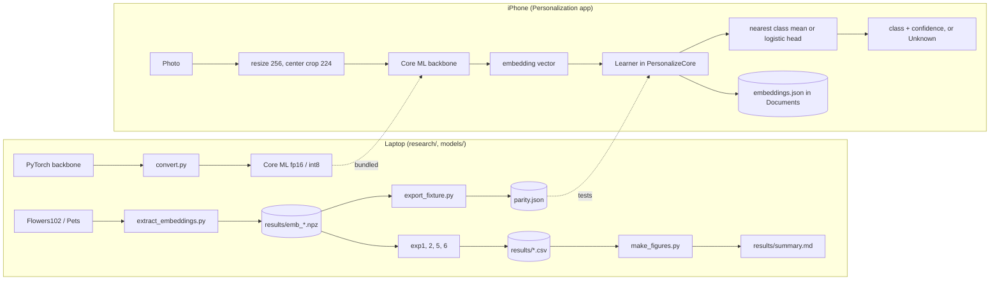

# On-device personalization

An iOS app that learns new image classes from a handful of photos, entirely on the phone. A frozen Core ML
backbone turns each photo into a vector; a small classifier head is fit on the device;
the app stores only those vectors (not the photos). You teach it your own objects and nothing leaves the device.

> **Status.** The Swift package, both heads, the Python experiments and the app are built. The experiment
> numbers below come from a **2000-image random subset of Flowers102** (about 20 images per class), not the full
> datasets, and the Oxford-IIIT Pets dataset has **not** been run. Nothing has been measured on a real iPhone yet.
> The phone-vs-laptop gate check has only been run in the iOS Simulator (see Limitations). Treat the numbers as a preview.


## Architecture



- `PersonalizeCore/`: Swift package with no UI and no network code. `EmbeddingStore`, `NearestClassMeanHead`,
  `LogisticHead`, the `Head` protocol and `Learner`. Checked against the Python reference with `parity.json`
  (probabilities within 1e-4).
- `Personalization/`: the SwiftUI app (Teach, Recognize, Library, Settings, plus a Lab section for benchmarks).
- `research/`: Python experiments, one script per experiment, seeded, with constants in `research/config.py`.
- `models/`: Core ML conversion scripts. `results/`: raw CSVs, figures, `summary.md`, measurement protocol.

## Claims

All numbers are from `results/summary.md` (Flowers102 subset, 95% CIs, 100 episodes or seeds per cell).

| Claim | Number | Experiment |
| --- | --- | --- |
| DINOv2-small needs very few photos: 1 photo per class, 5-way | accuracy 0.996 [0.992, 0.999] (nearest class mean) | Exp 1 |
| MobileNetV3 improves strongly from 1 to 5 photos per class (nearest class mean) | 0.834 [0.811, 0.857] at k=1, 0.952 [0.942, 0.963] at k=5 | Exp 1 |
| Logistic is slightly better than nearest class mean for MobileNetV3 at k=5 | +0.009 [+0.004, +0.014] accuracy | Exp 2 |
| For DINOv2 the two heads are indistinguishable at k=5 | +0.000 [-0.001, +0.002] accuracy | Exp 2 |
| With replay, earlier classes stay recognized after 10 classes (MobileNetV3, nearest class mean) | 0.924 [0.916, 0.933] | Exp 5 |
| Without replay, a logistic head forgets almost everything (sequential, 10 classes) | MobileNetV3 0.000 [0.000, 0.000]; DINOv2 0.049 [0.040, 0.059] (replay: 0.935 and 0.999) | Exp 5 |
| Nearest class mean does not forget, because class means never change | 0.924 [0.916, 0.933], identical to replay (MobileNetV3) | Exp 5 |
| Unknown detection works well with DINOv2 | AUROC 0.994 [0.992, 0.995] (nearest class mean) | Exp 6 |
| ... and clearly worse with MobileNetV3 | AUROC 0.885 [0.876, 0.895] (nearest class mean) | Exp 6 |
| The PersonalizeCore threshold rule rejects unseen classes with DINOv2 | 0.984 [0.978, 0.990] rejected, 0.956 [0.949, 0.962] taught accepted | Exp 6 |
| ... but not with MobileNetV3 | 0.277 [0.252, 0.302] rejected, 0.976 [0.972, 0.981] taught accepted | Exp 6 |
| fp16 conversion is essentially lossless | mean cosine 0.9999 (both backbones) | Conversion check |
| int8 hurts MobileNetV3 much more than DINOv2 | mean cosine 0.9224 (worst image 0.8303) vs 0.9992 | Conversion check |
| Simulator embeddings track the Python ones closely but not perfectly (MobileNetV3, 20 images) | mean cosine 0.9947, worst image 0.9855; same predicted class 100% for both heads | Gate check (simulator, CPU-only) |

Worst cases kept in: MobileNetV3 with one photo per class is the weakest cell in Exp 1 (0.834). The "newest class
only" arm in Exp 5 (the Learner's `replay = false`) scores 0.000 **by construction** (a head fit on one class can only
predict that class); the sequential arm is the fair forgetting test. MobileNetV3 nearest-class-mean confidence is
badly calibrated (ECE 0.507 [0.497, 0.517]); the softmax temperature (0.1) was not tuned.

## On-device measurement protocol and device

The protocol is written in [`results/measurement_protocol.md`](results/measurement_protocol.md): real iPhone,
Release build, 10 discarded warm-ups, 100 timed repeats, thermal state before and after, median and 95th
percentile. **No on-device measurement has been taken yet, so there is no device and no latency number.** The
only timing seen so far was a Debug build in the iOS Simulator and is not reportable.

## Limitations

- **Simulated users.** The public datasets stand in for people teaching the app; Exp 8 (real photos taken on
  different days) has not been run, and its sample will be small (a few classes, one person).
- **Subset only.** Numbers come from 2000 Flowers102 images; Pets and the full datasets are not run. At k=20 few
  classes are eligible in the subset, so those intervals are optimistic.
- **One device (planned).** Nothing is measured on hardware yet, and the plan covers one phone and one OS version.
- **Gate check is simulator-only.** With default compute units the iOS Simulator returned all-zero embeddings from the
  fp16 Core ML model, so the app runs it on the CPU there (`#if targetEnvironment(simulator)`). With that, 20 bundled
  images give mean cosine 0.9947 against the Python embeddings (worst image 0.9855), below the 0.999 target; the
  most likely cause is the resize method. It has **not** been run on a real iPhone (see `research/compare_device.py`).
- **Backbone vs preprocessing parity.** Python resizes with Pillow (bilinear, antialiased) and the app uses
  Core Graphics; small differences are expected and are exactly what the gate check measures.
- **Threshold rule.** The app's threshold applies to the head's top probability, while the offline rule is on
  cosine similarity to class means; the two are not the same quantity.

## Reproduce the offline results

```bash
python3 -m venv research/.venv --system-site-packages && research/.venv/bin/pip install pytest
PYTHON=research/.venv/bin/python bash research/reproduce.sh      # extraction + experiments + figures
research/.venv/bin/python -m pytest research/tests               # sampler, heads, metrics tests
cd PersonalizeCore && swift test                                  # Swift unit and parity tests
```

The first run downloads both datasets and the model weights (large; the Oxford server can be slow). Core ML conversion
(`models/convert.py`, `models/check_conversion.py`) uses a separate Python 3.11 environment with `torch==2.7.0`
and `coremltools` 9.0, because coremltools 9.0 has no native modules for Python 3.14.

## Privacy

- **Stored on the device:** class names and embedding vectors (lists of numbers), in the app's Documents folder
  (`embeddings.json`). If you turn off "Delete photos right after embedding" in Settings, the photos are also kept
  there. The Lab's real-photo tool stores only vectors with a class and a day label.
- **Never sent anywhere:** the app has no network code, no analytics, no third-party packages, and no cloud
  models. An audit of the Swift sources found no use of `URLSession`, `Network`, `WebKit`, `CloudKit` or any
  analytics SDK. The build settings turn outgoing and incoming network connections off
  (`ENABLE_OUTGOING_NETWORK_CONNECTIONS = NO`, `ENABLE_INCOMING_NETWORK_CONNECTIONS = NO`), there is no
  entitlements file, and no App Transport Security keys are set.
- **Only the camera permission is requested** (`NSCameraUsageDescription`). The photo picker needs no permission.
- **Exports are manual.** The Lab screens can write JSON/CSV files that you choose to share through the system share sheet.
- **Known leftover:** the project's `docs/` folder and a few text files sit inside the synced app folder and are
  copied into the app bundle. They contain no user data and no network code, but do not belong in a shipped app.

## Licenses

| Item | License | Status |
| --- | --- | --- |
| DINOv2 code and weights | Apache 2.0 (stated in the facebookresearch/dinov2 README) | Checked |
| torchvision code | BSD 3-Clause | Checked; the license text says nothing about pretrained weights |
| MobileNetV3-Large `IMAGENET1K_V1` weights | Trained on ImageNet; no separate weight license found | **Not verified.** Check ImageNet terms (believed to restrict use to non-commercial research) before publishing or shipping |
| Oxford Flowers 102 | | **Not verified** |
| Oxford-IIIT Pets | | **Not verified** |
| Converted `.mlpackage` files, gate images | | Git-ignored; not redistributed |
